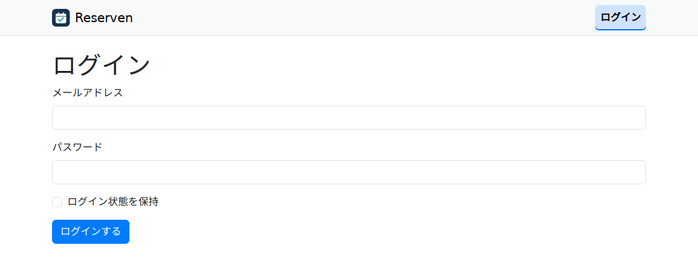
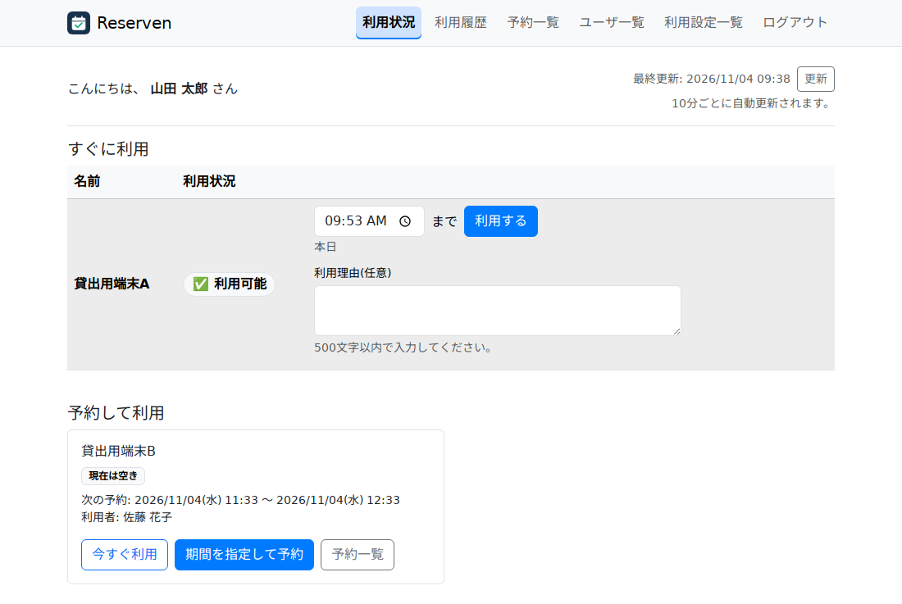
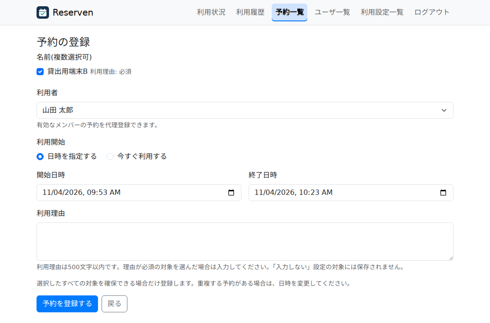
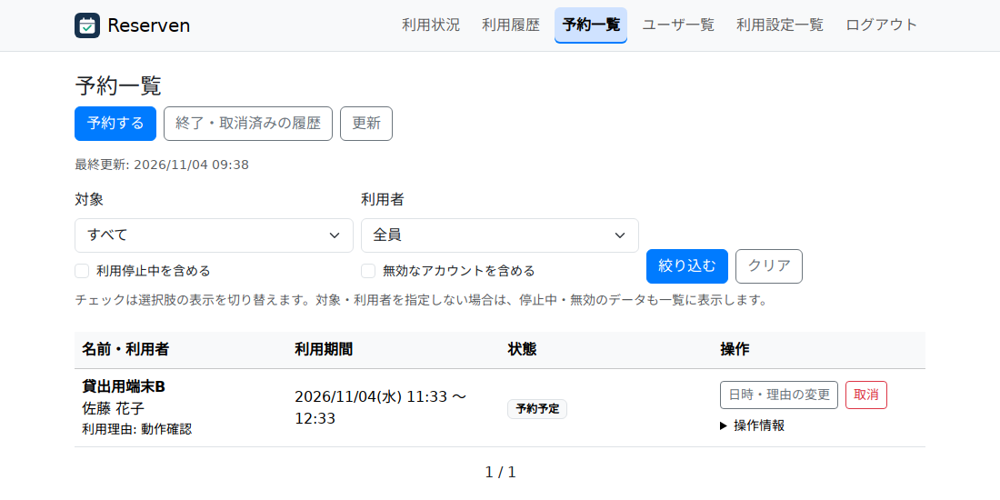
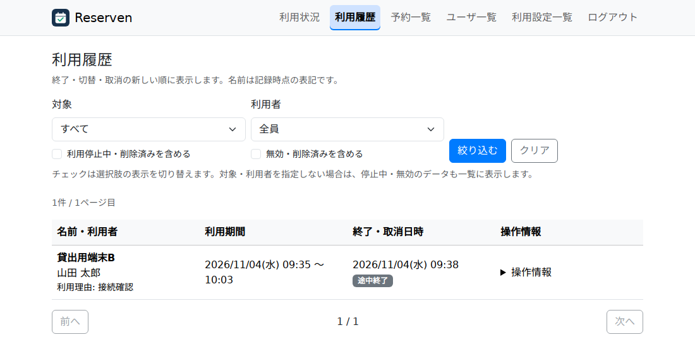
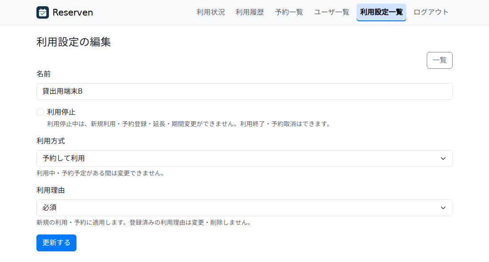

# Reserven 操作マニュアル

対象バージョン: main `fb7883e`

作成日: 2026年11月4日

画面例は架空のデータで撮影しています。表示される項目や操作は、権限や対象の設定によって異なります。

## 1. ログインと画面の見方

1. 管理者から案内されたReservenのURLを開きます。
2. メールアドレスとパスワードを入力し、「ログインする」を押します。
3. 共用端末では「ログイン状態を保持」を外し、操作後は「ログアウト」を押して確認画面で確定してください。

- **利用状況**: 今使える対象、現在の利用者、次の予約を確認し、利用や予約を始めます。
- **予約一覧**: 現在・今後の予約を確認します。本人または利用管理者は、予約の状態に応じて変更・取消・利用終了を行えます。
- **利用履歴**: 終了した利用や予約、取り消した予約を確認します。
- **ユーザ一覧・利用設定一覧**: システム管理者がユーザや利用対象を管理します。

スマートフォンなど画面が狭い場合は、上部のメニューボタンから各画面を開きます。

メールアドレスとパスワードを入力するログイン画面。

## 2. 「すぐに利用」の対象を使う

即時利用の操作と次の予約を確認できる利用状況画面。

### 利用を開始する

1. 「利用状況」で、対象が「利用可能」であることを確認します。
2. 利用期限の時刻を入力します。利用理由欄がある場合は、対象の設定に従って入力します。
3. 「利用する」を押します。日付をまたぐ場合は、確認画面で日付と時刻を確認し、「確定する」を押します。
4. 利用者名と利用期限が表示されたことを確認します。

現在より後の時刻は当日、現在より前の時刻は翌日の期限になります。現在と同じ時刻は指定できません。例えば22:00に「01:00」を指定すると、翌日の01:00が期限です。

### 利用を延長・終了する

- 延長する場合は、現在の期限より後の時刻を指定して「延長する」を押します。翌日になる場合は日付を確認して確定します。
- 利用を終えたら「利用終了」を押します。確認画面を挟まず、すぐに反映されます。

期限後の15分間は猶予期間です。その後は別の利用者が利用を開始できます。別の利用者に切り替わるまでは、元の利用者も延長・終了を操作できます。

「利用状況」は10分ごとに自動更新されます。期限や理由の入力中は自動更新が止まります。手動で「更新」を押すときは、入力を破棄してよいか確認してください。

## 3. 「予約して利用」の対象を使う

### 日時を指定して予約する

1. 「利用状況」の対象から「期間を指定して予約」を押すか、「予約一覧」から「予約する」を押します。
2. 対象を選び、「日時を指定する」を選択します。
3. 開始日時、終了日時、必要な利用理由を入力します。
4. 「予約を登録する」を押し、「予約一覧」で日時と対象を確認します。

対象と開始・終了日時を選ぶ予約登録画面。

同じ利用者・利用期間で複数の対象を使う場合は、一度に選択できます。1件でも重複などで登録できない場合は、選択したすべての予約が未登録になります。

同じ対象の予約期間は重ねられません。例えば、09:00〜10:00の予約に続けて10:00〜11:00を予約できます。09:30から始まる予約は重複します。

### 今すぐ利用する

1. 「利用状況」の対象から「今すぐ利用」を押します。
2. 「今すぐ利用する」が選択されていることを確認し、終了日時と必要な利用理由を入力します。
3. 「予約を登録する」を押し、戻った「利用状況」で予約期間を確認します。

開始日時には「登録時点の時刻」と表示されます。実際の開始日時は登録時に決まります。次の予約と重なる場合は、終了日時を調整してください。

### 変更・取消・途中終了

| 予約の状態 | 操作 |
| --- | --- |
| 開始前 | 「日時・理由の変更」で変更し、「更新する」で保存します。不要になった予約は「取消」で取り消します。 |
| 予約期間中 | 「期間・理由の変更」で終了日時と理由を変更できます。早く使い終わった場合は「利用終了」を押します。 |
| 終了・取消済み | 「利用履歴」で確認できます。 |

予約期間中は開始日時を変更できません。「利用終了」を押すと、残りの期間は予約可能になります。期間予約に15分の猶予はありません。

編集中に別の人が予約を変更した場合、古い画面からの保存は拒否されます。表示された最新の内容を確認してから、必要な変更を入力し直します。

## 4. 予約一覧と利用履歴を確認する

対象・利用者で絞り込める予約一覧。

1. 上部メニューから「予約一覧」または「利用履歴」を開きます。
2. 必要に応じて「対象」「利用者」を選び、「絞り込む」を押します。「自分」を選ぶと、自分の記録に絞れます。
3. 選択肢に利用停止中・無効・削除済みの項目を表示する場合は、対象または利用者欄の該当チェックを入れます。「クリア」で条件を解除できます。

チェックは選択肢の表示を切り替えます。対象・利用者を指定しなければ、停止中や無効の対象・利用者の記録も一覧に含まれます。

ログインできる利用者は全員分の履歴を確認できます。履歴には記録時点の名前が表示され、「操作情報」で登録者・最終更新者・終了や取消を行った人を確認できます。

利用期間や途中終了を確認できる利用履歴。

## 5. 利用管理者の操作

利用管理者は、予約登録画面の「利用者」欄で有効なユーザを選び、代理登録できます。予約一覧や利用状況に表示される操作ボタンから、他の利用者の予約を変更・取消・途中終了できます。「すぐに利用」の延長と終了も代行できます。

無効なアカウントの予約や利用停止中の対象を整理する場合は、開始前なら「取消」、予約期間中なら「利用終了」を使います。Slack通知には代理操作を行った人が「操作者」として表示されます。

## 6. システム管理者の設定

### ユーザを登録・編集する

1. 「ユーザ一覧」で「新規登録」または対象ユーザの「編集」を押します。
2. 名前、メールアドレス、パスワードなどを入力し、必要な権限を設定します。
3. 「登録する」または「更新する」を押します。

ユーザ・利用設定を管理する権限と、利用・予約を代行する「利用管理者」権限は独立しています。アカウントを無効にするとログインできなくなります。利用や予約の記録は保持されるため、必要な予約は利用管理者が整理してください。

### 利用対象を登録・編集する

1. 「利用設定一覧」で「新規登録」または対象の「編集」を押します。
2. 名前と利用方式を設定します。当日など短時間の確保には「すぐに利用」、開始・終了日時を指定して確保する対象には「予約して利用」を選びます。
3. 利用理由の入力設定を「入力しない」「任意」「必須」から選びます。入力できる理由は最大500文字です。
4. 「登録する」または「更新する」を押します。

利用方式と利用理由の入力設定を選ぶ利用設定画面。

利用停止にすると新たな利用・予約は登録できません。有効な予約や終了していない即時利用がある場合は、方式変更や削除の前に利用・予約を整理します。

### 並び順を変更する

「ユーザ一覧」または「利用設定一覧」の「並び順変更」を開きます。行のハンドルをドラッグするか上下ボタンで移動し、「保存する」で反映します。対象の並び順は「利用状況」にも反映されます。

## 7. Slack通知と困ったときの確認

Slack連携が設定されている場合、即時利用の開始・延長・終了や、予約の登録・変更・取消・途中終了を通知します。一括予約の登録は1通知です。利用終了通知では利用理由を省略します。予約の開始・終了時刻に達しただけでは、通知やリマインダーは送信されません。

- **通知失敗の警告が出た**: 利用・予約の操作は保存されています。一覧で結果を確認し、同じ操作を繰り返さず管理者へ連絡してください。
- **重複エラーが出た**: 「予約一覧」で該当期間を確認し、対象または日時を変更してください。
- **最新の内容を確認するよう表示された**: 最新の予約や利用状況を確認し、必要な変更を入力し直してください。
- **対象が選べない**: 利用停止中か、選択した利用方式の対象であるかを確認してください。
- **ログインできない**: メールアドレスとパスワードを確認し、解決しない場合は管理者へ連絡してください。
